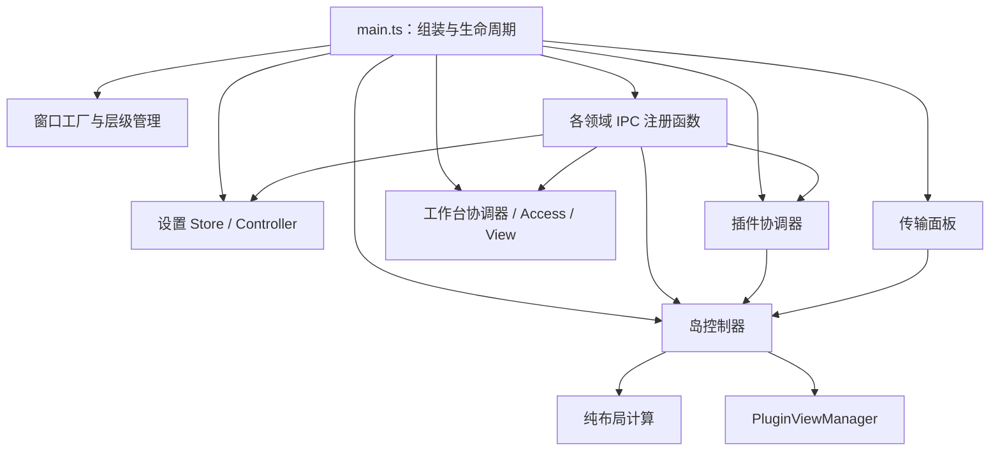

# 主进程代码导航

`electron/main.ts` 是组装入口。阅读顺序是：资源与设置 → 领域组件连接 → IPC 注册 → 启动 → 退出。具体业务从下表进入。

| 要修改的行为 | 入口 | 状态归属 |
| --- | --- | --- |
| 配置读取、保存、数值限制与设置生效 | `settings/store.ts`、`controller.ts`、`ipc.ts` | 设置文件由 Store 管理，用户变更由 Controller 协调 |
| 设置窗口与插件自定义设置页 | `settings/windows.ts` | 设置窗口、内嵌面板及其关闭状态 |
| 插件启停、模式、参数、事件、旧配置迁移 | `plugins/coordinator.ts`、`ipc.ts` | 插件相关偏好和运行时协调 |
| 开发目录监听与热重载 | `plugins/reloader.ts` | 同步抑制窗口、重载风暴计数 |
| 插件工具页实时内容 | `plugins/tool-state.ts` | 工具数据覆盖和校验 |
| 插件或工作台的 ZIP 导入 | `plugins/package-installer.ts` | 临时目录、清单识别和安装分流 |
| 插件包与生成规范导出 | `plugins/package-export.ts`、`skill-export.ts` | 打包规则与保存对话框 |
| 岛的展开、收起、悬停、提醒与视图切换 | `island/controller.ts` | 动画缓存、过渡序号、计时器、命中状态和仲裁器 |
| 尺寸计算、mini 条装箱与坐标转换 | `island/geometry.ts` | 无应用状态的计算函数 |
| 主窗口配置、崩溃恢复、窗口层级 | `window/host-window.ts`、`window-layer.ts` | 单个窗口的恢复计数、全屏隐藏与置顶协调 |
| 通知历史与清空确认窗口 | `notifications/windows.ts` | 历史窗口、确认窗口与待完成的用户选择 |
| 文件传输面板、拖放与 mini 进度 | `transfers/panel.ts`、`ipc.ts` | 页面加载、面板尺寸、拖放和进度展示状态 |
| 工作台启用、授权、参数、缩略图和快捷方式 | `workbench/coordinator.ts` | 工作台偏好与目录管理协调 |
| 工作台当前身份与能力校验 | `workbench/access.ts` | 当前身份、声明能力集合 |
| 工作台页面创建、切换与加载重试 | `workbench/view.ts` | 唯一页面、加载 Promise 和已加载入口 |
| 工作台尺寸策略 | `workbench/size.ts` | 请求尺寸及最终钳制尺寸；实例由岛控制器持有 |
| 工作台页面 API / 管理页面 API | `workbench/ipc.ts` / `management-ipc.ts` | 各自的 IPC 参数检查和调用适配 |
| 托盘、开机启动、资源路径、媒体键 | `system/` | 对应系统适配，不持有其他领域的全部状态 |

## 依赖如何连接

构造组件时不启动外部服务。组件间少量双向协作通过明确的操作接口连接，例如插件启停后请求岛重新布局。需要在稍后创建的服务或视图使用 getter，避免注册时把 `null` 捕获成永久快照。没有将全部服务和可写状态集中到一个 AppContext，也没有要求 IPC 继承统一基类。

IPC 只接收调用并适配参数；独立业务操作优先放进对应协调器。窗口引用、过渡计时器、工具缓存和加载 Promise 都由对应组件管理，`main.ts` 保留跨领域的连接和启动顺序。新增功能先找所属领域，再决定是否需要新增接口。

## 兼容性与验证

- 所有原有 101 处 IPC 注册的名称、handle/on 种类和数量保持一致。`scripts/tests/ipc-contracts.cjs` 对照基线清单检查生产 TypeScript 输入，排除未接入的草稿。
- preload 路径由入口按构建目录传入，不随源码移动而改变。
- 渲染进程恢复时，岛控制器重新发送当前布局和提醒颜色，保留自定义光圈。
- CommonJS 的模块路径、导出和主入口的工作台测试接口保留。
- 参数存储仍使用原有 JSON 文件、`__settings` 键、插件 ID 和工作台命名空间。
- `npm run typecheck`、`npm test` 和 `npm run test:desktop` 覆盖类型、平台、IPC 契约、状态归属、热重载、参数和传输协议。
- 本轮真实 Electron 回归通过：点击展开、收起几何、插件 presence、弹簧动画、提醒光圈、工作台 API/管理/打开、插件包往返、后台脚本热重载、内置通知迁移、文件传输 UI、辅助窗口层级。
- 修复了退出时仍在加载的插件视图发送消息的竞态：`PluginViewManager.dispose()` 是终止操作，在途及后续 `ensure()` 返回 `null`；岛控制器取消过渡计时器与仲裁，重载器不会在等待页面加载后重新挂上监听。`test:shutdown` 验证在途加载取消和真实托盘退出，并拒绝未处理异常。

工作区中的 `shared/app-context.ts`、`shared/ipc-registry.ts` 和 `settings/ipc-handlers.ts` 是原有未提交草稿，未接入上述实现。构建和类型检查使用同一份生产文件清单，保留草稿文件本身供后续参考。
